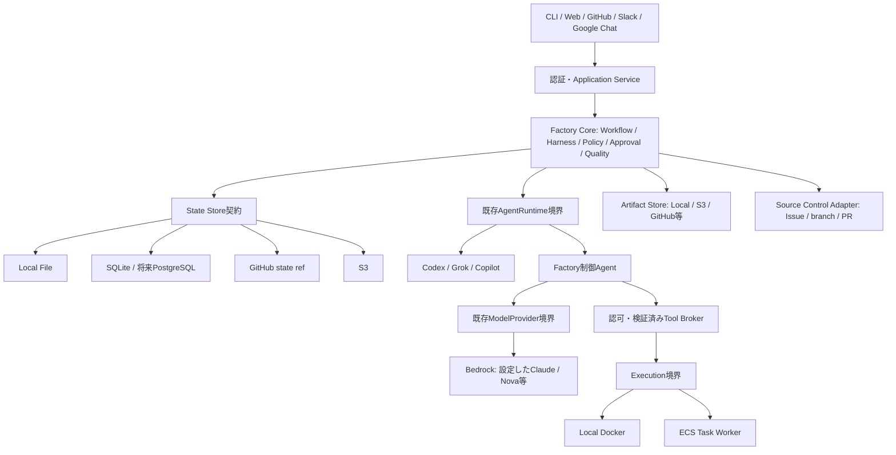

# AWSでも動くSoftware Factory：設計・ギャップ分析・実装計画

- 調査日: 2026-11-06（日本時間）
- 調査基準: `cc4faa75c41296d51e233a0a884dfc004e299244`（PR #86まで）
- 状態: **設計提案。今回は文書のみ。新しいStore・Dockerfile・AWSリソースは未実装。**
- 確認済み: ユーザーは「まず直列実行で確実な復旧を優先」を選択。同じRunは1 Worker、同じRepositoryの変更も直列。
- 最重要方針: AWS専用化せず、ローカル/AWS、保存先、Agent Runtime、Model Provider、Executionを独立に選ぶ。

## 1. 結論と今回の範囲

**専用DBを必須にしない構成は可能。ただし現在のSFはSQLite必須で、そのままではDBなしでは動かない。**
SQLiteも任意のState Store Adapterへ移し、SQLiteファイルを作らないLocal Fileモードを実際に検証する。
「DBサーバー不要のSQLite」と「DBそのものを使わないFile/GitHub/S3」は区別する。
DBなしでも永続状態は必要であり、状態を保存しない運転を復旧可能なFactoryとは扱わない。

推奨する初期構成:

| 利用形態 | 状態 | AI | 実行 | 成果物 |
| --- | --- | --- | --- | --- |
| 既存互換 | 任意のSQLite Adapter | 既存Codex/Grok/Copilot | 検証済みのLocal Docker等 | Local Artifact Adapter |
| DBを使わないローカル | Local File Adapter、同一hostの直列運転 | 既存Runtime、またはModelProviderを使うFactory制御Agent | 対応するLocal Execution | 永続volume内のファイル |
| GitHub中心・専用DBなし | GitHub専用state refによるAdapter（後述、将来実装） | 上記と同じ | Local/CI/Remoteの対応Adapter | GitHubまたは外部Artifact保存先 |
| AWS初期推奨 | GitHubはIssue/PR、S3は正式な実行状態・Artifact | 既存Bedrock Providerを使うFactory制御Agent等 | 信頼されたController Taskと、別の隔離Worker Task | S3、内容hash付き |

この表は目標の組合せであり、現在すべて動く一覧ではない。AWSの初期推奨は**オンデマンドTask**。
承認待ちの間は終了し、状態から再開する。常時API/Webが必要になったら受付Serviceを別に置く。
S3利用は推奨案であり、bucket/課金/運用設定の承認を得たという意味ではない。

今回行わないこと: AWSへの認証・Bedrock実推論・RunTask・ECR push・AWSリソース作成・deploy。
実装フェーズ、設計ADRの採用、クラウドで費用を伴う検証はそれぞれ別途確認する。

## 2. 既存実装とギャップ

文書の将来構想とコードの現在の能力を分けて評価した。

| 領域 | 実装の根拠 | 現在できること | 不足すること |
| --- | --- | --- | --- |
| Factory Core | `factory.py`、`test_factory.py` | SQLiteのTask/Run/Audit、外部Issueの重複取込み防止、限定read-only Runtime実行 | State Store切替、永続Workflow再開、実装からPRへの一貫処理 |
| Project/Repository | `local_project_registry.py`、`local_task_projects.py` | SQLite登録、Task→Project関連付け | SQLを使わない保存、複数入口の共通認可 |
| Agent Runtime | `runtime.py`、`agent_registry.py` | `execute(prompt, workspace, timeout)`。Codex/Grok/Copilot登録 | 共通の非同期handle/cancel、remote workspace、能力検査の完成 |
| Model Provider | `model_provider.py`、`custom_agent.py` | 推論契約と選択ファイルを使ったread-only分析 | 編集/ツールを持つFactory制御Agent。新しいAI大分類の追加は不要 |
| Bedrock | `bedrock_provider.py`、`model_provider_status.py`、`test_bedrock_provider.py` | boto3 Converse、model/region指定、token usage、標準認証chainの利用 | toolUse/toolResult、詳細error、明示timeout/retry、料金/永続予算。実モデル互換性は未検証 |
| Harness | discovery/validation/composition/approvalと各テスト | 検出・検証・明示構成・対象hash/期限/一回使用の承認記録 | 保存先分離、生成/評価、全工程への適用 |
| Run固定 | `harness_runs.py`、`test_harness_runs.py` | 承認消費とprepared Run/manifest/auditの単一SQL transaction | 非SQLでも同等の原子性、実行/resume |
| Quality | `run_evidence.py`、`run_review.py`、`quality.py` | 対象版/差分/試行固定、0件test/不完全reviewの拒否 | 実collector/Runtime/Artifactとの接続。delivery適格はまだfalse |
| ソース | `source_snapshot.py`、`test_source_snapshot.py` | 承認commitのblob取得、metadata除外、hash検証 | Artifact保存先分離、remote Workerへの受渡し、結果diff回収 |
| Execution | `docker_execution.py`、`test_docker_execution.py` | networkなし・非root・tmpfs・資源制限・停止回収の限定実行器 | 汎用Execution契約、入力source/出力Artifact接続、ECS Adapter |
| Docker配布 | `.github/workflows/offline-isolation.yml` | GitHub runnerで隔離実機4試験成功の記録あり | **SF自身を配布するDockerfile/Composeはない**。Docker実行器とは別問題 |
| GitHub | Issue/Repository/Web/demo各module | Issue取得/取込み、origin照合、デモDraft PR | 実装結果に基づく安全なpush/PR、正式state保存、結果不明時の照合 |
| Web/CLI | `cli.py`、`web_api.py`、`web_launcher.py` | ローカルCLI/Web、登録・閲覧・限定操作 | 公開API認証/認可、コンテナ用起動設定。現Webはlocalhost専用 |
| 設定 | `config/factory.example.yaml`、`docs/configuration.md` | 設定の設計例、Bedrockの環境変数読込 | factory.yamlを全面的に解決するloader/Adapter選択は未実装 |
| 使用量 | `usage.py`、`usage_tracker.py` | 不明値をNoneで保持、メモリ上のtoken集計 | 永続使用量、事前予算確保、価格表/停止/失敗時照合 |

主な既存テスト: `test_harness_approval.py`、`test_harness_runs.py`、`test_run_evidence.py`、
`test_run_review.py`、`test_source_snapshot.py`、`test_bedrock_provider.py`。
過去の448テスト成功とhosted隔離試験は既存範囲の証拠であり、ECS/Bedrock自律開発の実証ではない。
今回の文書作成ではアプリのテストやAWS実接続を再実行していない。

### SQL依存の実際の範囲

`factory.py`、`harness_approval.py`、Project/Task関連Storeに加え、`harness_runs.py`、
`run_evidence.py`、`source_snapshot.py`、`implementation_preflight_web.py`、`web_api.py`が
`_connect`/`.db`/SQLへ直接依存する。Webにはsqlite例外の直接処理もある。
Task保存だけをFileへ変えても、承認・証拠・Project情報が別DBに残るためDB不要とは言えない。

維持するもの: Core/Adapter境界、既存Runtime/ModelProvider契約、Harness/Quality判定、scope/hash、
既存Task/Run ID、SQL版の承認原子性テスト、ローカルCLI/APIの互換性。
変更が必要なもの: 保存の責務配置、ローカルpathを含む成果物参照、起動/設定、外部操作の復旧。

## 3. 目標構成と責務

Coreはboto3/S3/ECS/GitHub SDKや接続URLを直接扱わない。
State Storeは実行の正本、Artifact Storeは大きなsnapshot/report/logの格納責務。
別々の既成実装を増やすのではなく、現在ファイルへ直接保存する処理を同じArtifact境界へ移す。
Coreが保持するArtifact参照はID/hash/format等とし、host絶対pathや期限付き認証URLを実行状態の正本にしない。
最初は一つのAdapterが状態と成果物の両方を実装してもよいが、操作と整合性契約は混同しない。

GitHub Issue/PRは開発要求・成果物・人の判断の管理先。ラベル/コメントはFactory状態の表示・入口とする。
CoreがWorkflow意味の正本を持つ方針は維持する。GitHubをState Storeに選んだ場合も、そのschemaをCoreが管理する。

## 4. State Storeの設計

### 4.1 SQL接続ではなくユースケースを隠す

提案するStateStoreは新規の汎用SQL/KVラッパーではない。既存Storeの判定ロジックを再利用し、
次のような業務操作と、その完了条件を契約にする。名前・引数は最初の小PRで確定する。

- Task作成/取得、外部identityからの重複しない取込み。
- Taskの期待versionに対する更新、Run/stepの開始・待機・終了・復旧。
- 承認対象/期限/失効の検査と、一回使用・Run作成・監査記録の原子的なcommit。
- 対象版/試行に一致するチェック/レビューの追記、状態不一致の拒否。
- 外部操作の予定/進行中/完了/結果不明の記録とoperation ID。
- Project/Repository登録と参照、Artifact参照の保存、一覧の再構築。

Core側はsqlite例外、ETag、Git commit SHAを保存先の制御フローとして使用しない。
Adapterはopaqueなrevisionと共通のConflict/AlreadyExists/Unavailable/Unsupported等を返す。
SDK型やraw SQL connectionを返す`transaction()`を共通契約にしない。

### 4.2 更新単位はTask Aggregateを第一候補とする

Task、同じTaskのRuns/attempts、Task限定承認、Workflow checkpoint、必要な監査head、
pending external operationsを一つの論理更新単位へまとめる。
「承認消費→Run作成→audit」を別objectに分けて、途中失敗を正常扱いしない。
既存`BEGIN IMMEDIATE`の保証は、この同一aggregateの条件付きcommitで維持する。

各更新はschema version、aggregate version、operation ID、base/target revision、入力hash、
approval scope、実行先handle、結果参照、終了理由を保持する。versionを戻す更新はしない。
大きなsource/reportは外部Artifactへ置き、内容hashと参照だけを状態に残す。
監査も無制限に一つのJSONへ増やさず、immutable chunkを先に保存し、同じstate commitでheadを指す。

Project catalogとTaskは別単位なので、複数単位の同時transactionは当然には提供できない。
初期は確認済みの直列運転を採用。別Task間で共有する承認や、全Taskをまたぐ原子的操作は必須にしない。
必要になればcoordination手順か、対応Storeの強いtransactionを選ぶ。

### 4.3 必須能力と選択時の検査

最低限、Task内の原子的commit、期待versionによる競合検出、create-if-absent、
operationの冪等性、schema互換性、復旧に必要な耐久性を契約試験で確認する。
複数aggregate transaction、別host間の同時更新、外部Task置換後の耐久性は追加能力として宣言する。
能力は実装名だけでなく、filesystem/volume/配置/アクセス権を含む構成から判定する。
不足能力の構成では起動を拒否する。

### 4.4 保存先ごとの実現可能性

| 保存先 | 初期用途 | 更新・競合 | 再起動/停止時 | 主な制約 |
| --- | --- | --- | --- | --- |
| Local File | DBなしローカルの第一候補 | 同一hostのlock、期待version照合、一時ファイル→fsync→atomic replace | 永続volumeならcontainer再作成後も復元 | NFS等を同一保証と見なさない。別hostの分散lockなし。OS/fsごとの耐久性試験が必要 |
| SQLite | 既存互換の任意Adapter | 既存transactionを活用 | ファイル配置次第 | SQLiteはDBなので、これだけでDBなし要件を満たしたと言わない。Fargate ephemeral上では消失 |
| GitHub state ref | GitHubだけで小規模運転したい場合の候補 | state用refを読み、親commitを固定して更新。非fast-forward拒否を競合として扱う | GitHubのcommitから復元 | API回数/遅延/branch管理/size/権限。Issue本文・ラベルだけでは同等の原子性がない |
| S3 | AWSの第一候補 | 初回If-None-Match:*、以後ETagのIf-MatchでTask objectを条件付き更新 | Task終了後も外部に残る | 複数object transactionなし。412/409を再読込・再判定する。単なる上書きは不可 |
| PostgreSQL | 将来の選択肢 | 複数行transaction、検索・索引 | 構成次第 | 運用/費用が増える。初期必須にしない |

永続性はAdapter名だけではなく配置で決まる。Local FileもSQLiteも、container内ephemeral領域だけなら
Task置換で失う。ECSの本番復旧要件には外部Storeを選び、起動前に構成を検証する。
ETagは内容SHA-256と同一視しない。状態の競合制御versionと、Artifact内容hashは分ける。

GitHub Adapterを実装する場合は、通常のsource branchやPRと別の専用ref/schemaを使う。
commitの親と最新refを照合し、force updateを禁止する。label/commentだけの方式は表示用の限定モード。
初期はGitHub Adapterを急造せず、Local Fileで契約を実証した後、S3/GitHubの選択を確定する。

### 4.5 一意性・障害復旧・外部操作

- 外部Taskはprovider/instance/repository/issueを正規化した安定keyへcreate-if-absentする。
  ランダムIDの新規作成を先に行い、後から別indexへ重複防止を書き込む方式は避ける。
- 既存のランダムTask/Run IDと承認hashは移行時に保持する。索引は投影として再構築できるようにする。
  repository rename/case/旧identityの扱いはfixtureで明示し、既存identityを勝手に付け替えない。
- Artifactを内容hashで先に保存・確認してから、stateが参照する。CAS失敗時の孤立Artifactは後で回収する。
  重要な状態が、未保存の成果物を指したまま成功にならないようにする。
- 外部操作はintentをstateに保存→実行→結果記録。Task再開時は既存operation IDとremote handleを照合する。
- ECS RunTaskはclientTokenを使う。ただし期限・eventual consistency・結果不明を考慮し、再実行を盲信しない。
- PR作成後に応答を失った場合は、対象Repository/head/base/既存PRを照合する。判別不能ならBLOCKEDとする。
- 推論APIの応答喪失時に「呼ばれなかった」と決めつけない。再課金の可能性を含め、初期は人へ戻す。
- leaseの期限切れだけで旧Workerが停止したとは見なさない。executorの終了を確認できない場合、replacementを始めない。
- 同じRepositoryの別Taskはcontrollerが直列に扱う。複数aggregateの予約が必要なら、先にRepositoryの予約intentを
  保存し、Task claim、終了確認、予約解除を復旧可能な手順にする。途中停止では保守的に塞ぎ、別Taskを開始しない。

DBを使ってもGitHub/ECS/Bedrockまで跨ぐexactly-once transactionは得られない。
保証は「同一状態の原子的更新＋冪等key＋外部照合」。不明な実行を成功/未実行へ推測で分類しない。

### 4.6 DBなしでは保証を制限する範囲

Local Fileで別hostの複数Worker、S3/GitHubで複数Taskの強い原子性、無期限の低遅延global検索、
厳密な外部操作exactly-once、Task終了直前に強制停止された未送信ログの完全保存は約束しない。
要件化された場合はStore能力の追加、queue/coordinator、または任意のPostgreSQL等を提案する。
不足能力の構成を起動時に拒否し、黙ってメモリや一時ディスクへfallbackしない。

## 5. Bedrockは既存Providerを拡張する

BedrockをCodex CLIと同じ「推論だけで完成したCoding Agent」とは扱わない。
既存`ModelProvider.generate`/`ModelResponse`/`TokenUsage`を再利用し、Factory制御Agentが
推論、tool requestの検証、Execution呼出し、tool result、再推論を回す。
そのAgentが既存`AgentRuntime`境界を実装する。Bedrock専用の第二Coreは作らない。

| 項目 | 方針 |
| --- | --- |
| SDK/認証 | boto3と標準credential chainを継続。ローカルはSSO/profile等、ECSはTask Role。固定keyや自動loginなし |
| モデル | model ID/inference profile/regionを設定化。Claude/Nova等の利用可能なモデルと機能を導入先で確認 |
| 能力差 | Converse対応でもtool use/structured output/parameterが同じとは仮定しない。未対応能力を実行前に拒否 |
| timeout | connect/read timeoutを明示し、workflowの絶対deadlineと実行キャンセルを別に管理 |
| retry | SDKとWorkflowの二重retryを避け、総回数と時間を制限。AccessDenied/設定不正は機械的に繰り返さない |
| error | 既存の共通error方針へ正規化。raw credential/request/sourceをログへ漏らさず、原因分類を維持 |
| usage/費用 | TokenUsageを保存。不明は0にしない。model/region/価格表versionを使う推計と実請求を分ける |
| 予算 | 推論前に保守的な上限をTask状態へ予約し、返却usageと照合。未知の請求は保留。予算通知だけを停止機能と見なさない |
| tool execution | modelの要求は提案。schema/path/command/permission/budgetをFactoryが判定し、隔離Executionへ渡す |

最初のAgentは「限定source snapshot→限定patch提案→許可pathへ適用→決定的test→独立review」の小さな縦断経路。
modelにGitHub tokenやAWS deployment権限を与えない。Codex等はその製品が制御できる範囲を明示し、
Factory brokerを通せないtoolを持つRuntimeをECSの安全な実行器と同等と扱わない。
既存の同期execute契約は当面維持し、必要なremote handle/cancel等を実装根拠に基づき段階追加する。

## 6. Docker配布とExecutionを区別する

**SFをDockerで配布することと、未信頼コードを安全に実行できることは別である。**

最初の配布imageはCLI/Controller向けとし、Python/Git/必要extraだけを含め、非root、exec形式entrypoint、
stdout/stderr、終了コード、SIGTERM時のcheckpointを整える。`.git`、`.venv`、認証ファイル、ローカルDB、
snapshot/logをbuild context/imageへ入れない。必要な依存はbuild時に固定・検証する。

ローカルは明示したstate/artifact volumeを使用する。既存SQLiteモードも保持し、Fileモードは移行完了後に選択可能にする。
`sf web`は現状localhost/browser起動/初回npm buildを前提とするため、そのまま公開しない。
Web配布はbuild済みasset、container用起動設定、認証/認可の別PRとする。

Core containerへhost Docker socketを既定でmountしない。Local Docker実行は信頼されたhost agent等の
明示構成とし、FargateではDocker daemon、privileged、host socketの存在を前提にしない。

## 7. ECS / Fargateの比較と推奨

| 比較 | A: 常時ECS Service | B: オンデマンドECS Task |
| --- | --- | --- |
| idle費用 | 待機中もcompute、構成次第でLB等 | job中のcompute。ただしS3/log/NAT等の費用は別 |
| 受付 | 常設API/Webhook/Webに向く | 別の受付、手動起動、または定期pollingが必要 |
| 応答時間 | 起動済みで早い | image取得・起動の遅延 |
| 承認待ち | 受付は常駐してもWorkflowは外部状態化が必要 | Taskを終了して待機し、新Taskでresume |
| 障害復旧 | Serviceが置換しても状態は外部から復元 | 再起動/再送時に状態と実行handleを照合 |
| 複雑性 | 常設認証、更新、health、同時実行制御 | 起動制御、durable trigger、再送・重複・照合 |
| 初期適性 | 常設UI/APIが主要求なら検討 | **現在の直列・Issue起点jobに推奨** |

初期AWS pilotは手動CLI起動または定期pollingで入口を絞る。GitHub Issueのready条件と承認を読み、
外部状態をclaimしてController Taskを開始する。受付を常時稼働させずに実証できる。
Slack/Chat/Webhookが必要になった時点で、認証・再送対策を持つ受付を別に置く。
受付がdurableな起動intentを保存する前に成功応答を返さない。SQS等はこの要件が出た時点で前倒し可能。

### Controllerと未信頼Workerは別Task

- Controller: 検証済みCore、必要最小限のBedrock/State/Artifact/ECS操作。GitHub発行処理も信頼領域に限定。
- Worker: source snapshotと許可commandだけ。Bedrock/GitHub/本番資格情報なし、stateの正本を書き換えない。
- 同じTaskのsidecarに分けただけではTask Roleの秘密分離を保証しない。特に生成コードをControllerと同居させない。
- WorkerへのArtifact転送では、Task Roleをそのまま共有しない。初期候補はjob対象object限定の短期署名URL等。
  URLも資格情報として扱い、prompt/image/log/state本文へ残さない。result用の書込先/期限/容量も限定する。
  EFS等の別案も含め、方式は実装前に脅威モデルとAWS実機で確定する。S3へ転送するWorkerに
  Dockerのnetwork=noneと全く同じ設定が使えるとは言わず、必要な通信先だけへ制限する。
- Execution Role（image pull/log等）とアプリTask Roleを区別する。RunTask/PassRoleは許可task definition/roleへ限定。
- Workerの非root/read-only rootfs、許可mount、Task/commandのCPU/memory/time上限、StopTask/終了確認を実機で検証。
- SGだけで任意hostname allowlistが実現するとは扱わない。egress proxy等とVPC接続を別途設計し、metadata/credential endpointも検証。
- FargateはTask資源制限の仕組みを使う。DockerのPID制限やcapability設定と同一機能があると仮定しない。
  必須の隔離要件をFargateで満たせなければ、EC2/別VM/別実行基盤を任意Adapterとして提示し、安全性を下げない。
- Source/Artifactはtask_id/run_id/hashに固定。Taskのlocal pathを次のTaskでそのまま参照しない。
- deadline監視・停止はWorker内だけに頼らず、信頼されたController/外部監視が担う。
  Controller自体が停止しても孤立Workerを発見・回収できるよう、handleと期限を永続化する。

## 8. 再起動・承認待ちの復旧シナリオ

1. Issueを同じexternal identityで取り込み、既存Task/Runを読み込む。
2. 権限・Harness版・入力commit・現在のapprovalを検査する。
3. 既存の実行/推論/PR操作intentを先に照合。RUNNINGを見たから新しく実行し直す、とはしない。
4. 実行中なら既存handleへ接続、終了済みならhash付き結果を収集。不明ならBLOCKED。
5. 承認待ちはWAITING_FOR_APPROVALを外部へcommitしてTaskを終了する。
6. 認証済みの承認操作が同じscope/hashへ判断を保存し、次の起動がversionを確認してresumeする。
7. 品質・独立reviewが同じ対象commitで揃った時だけ、別の権限でDraft PRへ提出する。
8. Merge/Release/Deployは独立の人間承認。外部のmerge結果を確認して次工程へ進む。

M1〜M5の最終ゴールは変更しない。本設計はM1の承認、M2の実行/復旧、M3のIssue-to-PRを
ローカルとAWSの両方で成立させるための変更であり、AWS対応自体をゴールにしない。

## 9. 小さなPRへ分けた実装ロードマップ

以下は計画ID。実装済みPR番号ではない。各段でSQLを残す範囲と、利用可能な構成を明示する。

| ID/Phase | 目的・変更範囲 | 検証方法・完了条件 | 依存 |
| --- | --- | --- | --- |
| P01 / 設計→状態 | StateStoreの最小契約・共通error・Task create/get/import-onceを既存SQLiteから抽出。Factoryの公開挙動維持 | 既存Task ID/重複取込み/rollbackのcontract test。AWS型/SQL connectionが契約へ漏れない | 設計レビュー |
| P02 / 状態 | Local Fileの同じTask操作。lock/version/atomic replace/schemaを実装 | 同時create/updateで一方だけ成功、途中終了/壊れたJSON/lock不可を拒否。まだ全SFのFile選択は公開しない | P01 |
| P03 / 状態 | Run/checkpointとTask限定承認の一回消費・prepared Run/auditを共通の原子操作へ移す | 既存の同時消費/DB障害試験をFile/SQLiteへ共通適用。失敗時に承認だけ失わない | P02 |
| P04 / 状態 | evidence/review/snapshot参照とProject/Task関連付けをStore経由へ移す | 版・試行・scope不一致の拒否、Fileでも同等の履歴。Web/preflightのSQL直接呼出しを除去 | P03 |
| P05 / 移行・復旧 | 完全なFileモードの設定とSQLite export/import。起動時能力検査 | sqlite3.connectを禁止したCLI/内部サービスの縦断test、再起動で承認待ち復旧。旧ID/hash維持、dry-run移行、バックアップ | P04 |
| P06 / Docker | CLI/Controller Dockerfileと.dockerignore、最小実行説明。既存SQLiteもvolumeで動く | 非root起動、help/doctor、Secret非包含、終了コード、volume保存/再作成。FileモードはP05後に試験 | P01と独立に開始可 |
| P07 / Bedrock | 既存Providerへtimeout/retry/error正規化・parameter能力検査を追加 | SDK stubでtimeout/throttle/access denied/不正応答/Claude・Nova等の設定切替。実課金呼出しは承認後のみ | 設計レビュー、P01と独立 |
| P08 / Agent | 既存AgentRuntimeを実装するFactory制御Agent。限定tool/patch提案をExecutionへ渡す | 偽tool/path/未承認操作/予算超過を拒否。fake Providerで契約、実model/Executorで別途通し試験 | P07、既存Harness/Execution |
| P09 / Artifact | Local Artifact契約へ既存snapshot/report保存を移す | 内容hash照合、領域外/改変拒否、孤立生成物の回収。stateは参照のみ | P04、P08のremote接続前 |
| P10a / S3 State | S3のTask条件付き更新だけを実装 | stubでIf-Match/If-None-Match、412/409、応答喪失を検査。実S3試験は承認後 | P05、保存先確認 |
| P10b / S3 Artifact | 内容hash付きArtifactの保存/取得/検証 | 改変/不足/部分upload/孤立objectを検査。実S3試験は承認後 | P09、保存先確認 |
| P10c / GitHub State（任意） | GitHub専用refで同じTask契約を実装 | parent/ref競合、非fast-forward、API応答喪失。Issue/labelだけで代替しない | P05、GitHubだけでの運用要件がある場合 |
| P11a / Execution | 既存Dockerへ必要なhandle/cancel/Artifact契約を適用 | timeout/停止/回収、sourceと結果のhash/版を既存実機試験へ接続 | P08/P09 |
| P11b / ECS | ECS RunTask/Describe/Stopで同じ実行契約を実装 | AWS stubsでclientToken、未知handle、停止失敗、期限・権限の負例。実Task起動は承認後 | P10a/P10b/P11a |
| P12 / AWS pilot | 設定例/IaC案、役割分離と外部状態からのTask再開 | 承認後にECSで実装→test→review→Draft PR。承認待ち終了/Task強制終了/再送/応答喪失を実測 | P06/P11b、AWS実施承認 |
| P13 / 常設入口・並列 | 必要に応じAPI/Chat、queue、複数Worker、監視 | 認証/認可、重複イベント、同Repo競合、停止/予算、孤立Task回収。必要なStore能力を確認 | 直列pilot実測 |

P12のIaC/設定案と、承認を得て行う実クラウド試験も別の変更・作業として扱う。
P01〜P05は大きな一括置換をしない。各PR中はSQLite既定を維持し、未移行機能をFileへ黙って混在させない。
File backendのTask操作が動いただけで「DB不要でSFが動く」と宣言しない。
SQLとFileのdual writeを既定の移行策にしない。移行時はwriter停止→検証済みexport→import→readback→切替。
復旧pointを残し、切替に失敗したら元の保存先へ戻す。Storeを消して作り直す方式は採らない。

### 最初のPRはP01だけにする

対象: 新しいStateStore契約とSQLite Adapter、FactoryのTask作成/取得/外部取込みの委譲、contract test。
対象外: File全機能、承認/Runの大移動、AWS SDK追加、新Dockerfile、設定の既定切替、リソース作成。

受け入れ条件:

- SQLite既定の既存Task/CLIテストが同じ挙動で通る。
- external identityの同時取込みがTaskを増殖させない。
- 保存失敗時の部分状態を成功にしない。
- 既存ID/DBを変更せず読み書きできる。
- P02が同じcontract testでFileを実装できる最小境界になっている。

これにより新しい抽象化を先に全域へ広げず、実際の二つ目の保存先で妥当性を検証する。

## 10. 今後確定する判断

| 判断 | 現在の提案/確認状態 |
| --- | --- |
| 初期同時実行 | **ユーザー確認済み: 直列で復旧優先**。再送・二重起動の対策は省略しない |
| DBなしの意味 | SQLiteも使わないFile/remoteモードを用意し、SQLiteは互換の任意Adapterに残す |
| AWSの保存先 | GitHub Issue/PR＋S3 State/Artifactを推奨。GitHubだけに限定する要件があればP10を変更 |
| ECS ServiceかTaskか | 初期はオンデマンドTaskを推奨。常設Web/APIが必須になれば受付Serviceを分ける |
| モデル/region/account | 今回固定しない。利用許可・機能・費用・データ境界を実接続前に確認 |
| AWSの実作業 | 明示承認前はcreate/deploy/inferenceを実行しない |

今回の調査・設計成果は本書。提案をレビューし、P01の契約を確定するまではアプリ構造を変更しない。

## 11. 参照と検証限界

既存の[全体設計](architecture.md)、[Adapter契約](adapter-contracts.md)、
[逆算ロードマップ](north-star-roadmap.md)、[承認とRunの原子性](decisions/0008-atomic-prepared-harness-runs.md)、
[実行境界](decisions/0005-trusted-execution-boundary.md)を基にした。

AWS仕様は公開された公式botocore定義のcommit `4f864a49768c46b419542bf3a120cdb893d31f4e` で読み取り確認した。
AWSへの実リクエストや認証は行っていない。

- [S3 API定義](https://github.com/boto/botocore/blob/4f864a49768c46b419542bf3a120cdb893d31f4e/botocore/data/s3/2006-03-01/service-2.json): PutObjectのIfMatch/IfNoneMatch、412/409。
- [ECS API定義](https://github.com/boto/botocore/blob/4f864a49768c46b419542bf3a120cdb893d31f4e/botocore/data/ecs/2014-11-13/service-2.json): Fargateのprivileged非対応、Task Role/Execution Role、RunTask clientToken。
- [Bedrock Runtime API定義](https://github.com/boto/botocore/blob/4f864a49768c46b419542bf3a120cdb893d31f4e/botocore/data/bedrock-runtime/2023-09-30/service-2.json): ConverseのtoolConfigとモデル別機能への注意。

これらはAPI能力の根拠であり、実際のIAM/VPC/課金/モデル利用可否や障害復旧を検証した証拠ではない。
SDK最低versionと実サービスの機能、対象OS/fsは実装PRで別途検証する。

## 実装進捗

| 計画 | 状態 | 証拠・残る範囲 |
| --- | --- | --- |
| 設計 | PR #87でマージ済み | 今後の変更に合わせて更新 |
| P01 | PR #88でマージ済み | Task保存をSqliteStateStoreへ委譲。全FactoryのDB不要化ではない |
| P02 | PR #89でマージ済み | File Task保存。[単体確認手順](local-file-state.md) |
| Webへの接続 | PR #90で実装・ローカル検証済み | [一コマンド起動](local-web-storage.md)。FileでTask/Project/Repository/binding/read-only Runを保存。既存SQLiteを維持 |
| P03以降 | 主要部分は未実装 | 承認とprepared Runの原子操作、証跡、Worker復旧、移行は後続。Web接続で完了扱いにしない |
