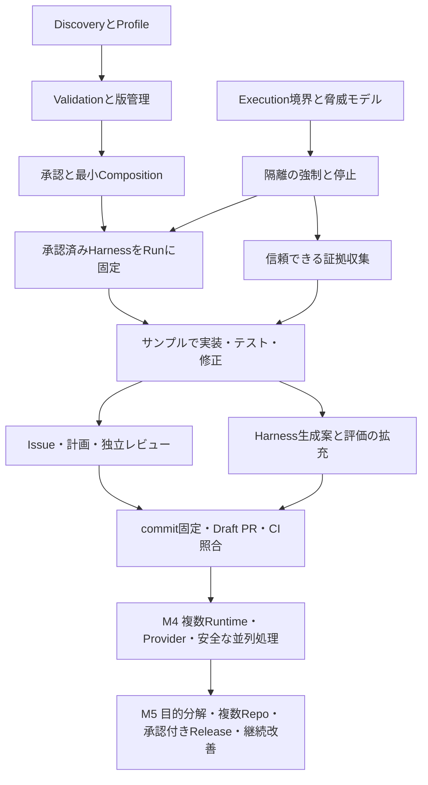

# Software Factory — 最終ゴールと逆算ロードマップ

- 更新日: 2026-11-08（UTC）
- 調査基準: `e2841cc6e2da8cb955eece15ba10b9d1ba8327ff`
- 状態: 最新の実装範囲は「2026-11-08の現在地」を参照。初回調査の表は履歴として保持。
- 対象: 既存コード・テスト・設計資料のギャップ分析と、M1〜M5への実装順序。

## 2026-11-08の現在地

| 到達点 | 現在の接続 | 未完了の条件 |
| --- | --- | --- |
| M1 Harness | Discovery/Validation/選択/承認/Run固定、Project共通＋Repository＋変更directoryを接続 | 生成・継続評価・改善の全自動化 |
| M2 安全な実行 | FileでDB不要、exact source snapshot、offline Docker、実check/review証跡、durable配送 | 分散Worker、全実行形態の復旧・クラウド実行 |
| M3 Issue→Draft PR | Bedrock/Copilot text adapterとローカルCLI、有限の同一PR修正、子Issue DAGの直列実行・merge照合 | PCのBedrock＋GitHubで実サービス通し確認。複数利用者・分散実行 |
| M4 開発基盤 | 既存Project/Web/Adapter境界を再利用 | 並列処理、複数利用者認可、監視・コスト可視化 |
| M5 自律Factory | 要件分割・受入条件・外部子Issueの最小経路を接続 | 複数repo統合、承認付きrelease、継続的Harness改善 |

[#114](https://github.com/KOHEIITOH/generic-software-factory/pull/114) は永続予算、
[#115](https://github.com/KOHEIITOH/generic-software-factory/pull/115) はPR snapshot/CAS、
[#116](https://github.com/KOHEIITOH/generic-software-factory/pull/116) はProject/Directory Harness、
[#117](https://github.com/KOHEIITOH/generic-software-factory/pull/117) はremote source評価、
[#118](https://github.com/KOHEIITOH/generic-software-factory/pull/118) は有限レビュー修正。
子Issue Adapterと要件workflowの検証・判断はADR 0041/0042および
[利用手順](bounded-issue-workflow.md)で管理する。実Docker CIではモデル/SCMを模擬し、
実サービスE2Eと区別する。要件/品質失敗や予算切れは証跡を残して停止し、確認待ちの無限loopは作らない。

## 1. North Starと判断基準

人間が開発目的を伝えると、Factoryが要件整理、設計、タスク分解、実装、テスト、独立レビュー、修正、Draft PR、承認付きリリース、実行結果からの改善までを統制する汎用プラットフォームを目指す。人間は目的設定・重要判断・最終承認に集中する。

特定のAIモデル、Agent Runtime、言語、開発対象、Gitサービス、実行環境をCoreの必須前提にしない。初期実証では対象を絞り、次の実装で交換可能性を検証する。Issue-to-PRは価値を測る最初の大きな到達点であり、最終ゴールの一部である。

各PRは「利用者の工程のどこを進めるか」「再利用する既存機能」「受け入れ条件」「安全な失敗」を説明する。新しい抽象化や対応製品の追加だけでは完了としない。

### スコープの読み方

本書のM1〜M5はユーザー指定の新しい到達目標である。[旧MVP計画](mvp-plan.md)のM0〜M4とは番号の意味が異なる。本書を今後の逆算計画の基準案とし、旧資料は経緯・個別設計として参照する。既存のCore契約・Policyを本書だけで変更しない。契約・セキュリティ・Workflowの意味を変える実装PRには、既存方針に従いADRを付ける。

## 2. 初回調査時点の記録と証拠

判定は次の粒度を使う。

- **実装済み**: 記載した限定範囲のコードとテストがある。製品全体の完成を意味しない。
- **一部実装**: 部品や限定経路はあるが、必要な統合・強制・永続化・実接続のいずれかが不足。
- **未実装**: 調査したコードに対象の実行経路がない。文書・設定例だけでは実装扱いしない。

前回の環境セットアップ時には247テスト、Ruff、Pyright、Webビルド、7経路のHTTP確認が成功した。これは開発環境と既存機能の検証であり、任意リポジトリの安全なAI編集やIssue-to-PRの実証ではない。AI認証・実Runtime接続は未検証。本書作成時にこれらのチェックを再実行したという意味ではない。

| 領域 | 現在の実装・証拠 | 状態とギャップ | 主な到達先 |
| --- | --- | --- | --- |
| Project管理 | `local_project_registry.py`、`repository_contracts.py`、`web_api.py`、`test_local_project_registration_api.py` | 一部実装。File/SQLite登録・一覧・重複制御あり。所有者はローカル固定。Task/Runと一貫したProject境界、接続管理、複数利用者の認可は不足 | M1/M4 |
| リポジトリ検出・解析 | `repo_discovery.py`、`local_git.py`、`repo_analysis.py`、`test_repo_analysis.py` | 一部実装。Git root検出、明示パスの列挙、制限付きsnapshotのCopilot解析あり。Harness専用の検出・構造化Profile・再検出は未実装 | M1 |
| Harness Discovery | `harness/`、`config/project.example.yaml`、`context_builder.py` | 未実装。テンプレートと明示ファイルの文字数制限付き読込はあるが、検出結果・根拠・適用範囲を管理しない | M1 |
| Harness Validation/Generation | 同上、`repo_analysis.py` | 未実装。既存解析は生成案の構造化・検証・保存・承認の代替にならない | M1 |
| Harness Approval/Composition/Integration/Evaluation | `approval_gate.py`、`quality.py`に汎用部品 | 未実装。Harness版・競合・承認対象・Runへの固定・評価履歴がない | M1/M3/M5 |
| Task/Run/Audit | `factory.py`、`test_factory.py`、`test_task_repository_binding.py` | 限定範囲は実装済み。File/SQLite保存・Issue重複防止・リポジトリ紐付けあり。`run_task`は空の専用ディレクトリで同期Runtime実行。紐付け先を実装対象として読み込む経路ではない | M2/M3 |
| AI Runtime | `runtime.py`、`agent_registry.py`、`codex_cli.py`、`grok_cli.py`、`copilot_sdk.py`と各テスト | 一部実装。3種の登録・同期execute・結果正規化あり。実認証・隔離下の編集互換性・能力別拒否・cancel/resume共通運用は未完成。Claude/Geminiは未登録 | M2/M4 |
| 要件・計画・Workflow | `workflow.py`、`workflow_runner.py`、`test_workflow_runner.py` | 一部実装。依存関係評価と読み取り専用の逐次実行あり。Factory DB・CLIと未統合。自然言語からの受け入れ条件・計画・Task DAG生成と承認は未実装 | M3/M5 |
| 隔離・作業領域 | `issue_worktree.py`、`dev_smoke.py`と各テスト | 一部実装。作業ツリー分離と同梱サンプル編集あり。worktree・一時ディレクトリはOS隔離ではない。任意コードを実行する信頼できるExecution Adapterは未実装 | M2 |
| 権限・承認 | `policy.py`、`risk_policy.py`、`execution_guard.py`、`execution_authorization.py`、`approval_gate.py` | 一部実装。既定拒否、Task/Repository/操作スコープの検査あり。`isolated=True`や承認データの呼出元申告だけでは隔離・本人性を証明しない。永続化・期限・失効・改変後再承認・全入口の強制が不足 | M2〜M5 |
| 品質・修正ループ | `quality.py`、`improvement.py`、`quality_loop.py`、`test_quality_loop.py` | 一部実装。必須証拠欠落の拒否・回数/時間上限あり。証拠は注入値。実テスト実行器、証拠とcommitの結合、独立レビュー、DB連携、実行の強制停止が不足 | M2/M3 |
| Git・Issue・PR | `github_issues_source.py`、`github_issue_web.py`、`github_repository_web.py`、`issue_worktree.py` | 一部実装。Issue取得・取り込み・Web選択、origin照合、worktree作成あり。push・Draft PR・更新時の重複防止・Merge実行器は未実装。Local Gitは読み取りのみ | M3/M4 |
| CI/CD・Release | `.github/workflows/`、`workflows/issue-to-pr.yaml` | Factory自身のCIは実装済み。対象プロジェクトのCI結果との照合、Release管理、承認付きDeploy/Rollbackは未実装。YAMLは実行済みWorkflowではない | M3/M5 |
| 観測・コスト | FactoryのFile/SQLite記録、`usage.py`、`usage_tracker.py` | 一部実装。usage集計はメモリ内で価格計算なし。不明値は不明として扱う。統合ログ、成果物、永続コスト、予算停止、失敗分類、保持・秘匿化が不足 | M2/M4 |
| Web/外部入口 | `web_api.py`、`github_issue_web.py`、`web/src/App.tsx` | 一部実装。閲覧に加えTask作成・Project/Repository登録・Issue取り込みあり。認証なしのloopback前提。実行・承認・cancel操作、認可、MCP/Slack連携は不足 | M3/M4/M5 |
| 継続改善 | `improvement.py`、`quality_loop.py` | 一部実装は同一処理内の再試行。Run横断の失敗分析、Harness改善案、比較評価、承認・Rollbackは未実装 | M5 |

根拠はすべて `src/sf_factory/`、`tests/` 配下の上記ファイル。実装内容とREADME・[Web API説明](local-web-api.md)の「閲覧専用」「Issue取り込み未実装」は一致していないため、コードとテストを優先した。説明の整合は後続の小さな文書PRで扱う。

### 最も大きいギャップ

部品不足だけでなく、**承認済みHarness → 信頼できる隔離実行 → commitに対応する品質証拠 → Draft PR**という接続がない。Runtimeの成功や247テストの成功を、この工程の完成判定に使わない。M1全体の完成を待たず、Harnessの最小経路とM2を接続することが最短の価値実証になる。

### 最新mainへの追従（2026-11-06）

PR準備時に `c85f39589dbe2081ec691b393f974c603378c49a` まで追従。
#67〜#74でWebのDraft PRデモと実装preflight/planが追加された。
`github_pr_demo_web.py` はデモマーカーをcommitしてDraft PRを作成する経路であり、
AI生成差分・品質証拠を伴うM3の実装ではない。`implementation_plan.py` は
trusted executor未接続を理由に実行可能判定を常に拒否する。R03/R04の必要性は変わらない。
今後のR13/R14では既存GitHub処理の共通化可否を評価し、重複を避ける。
ユーザーはPR作成、厳密な検証・レビュー後のマージ、継続実装を明示的に了承済み。

## 3. 依存関係と実装順序

M1/M2は相互に進める。Discovery・検証・承認の最小経路を先行し、M2の隔離が証明できてから編集を接続する。Generationの高度化や多数の形式対応は、実行から得た不足を基に追加する。M3までの標準実証は単一Project・Repository・Runtime・直列処理に絞る。

既存 `repo_analysis.py` のCopilot専用経路をDiscoveryの必須前提にしない。Discoveryはローカルで決定的に動作させ、AIによる解釈・生成は任意の後工程へ分ける。Coreは既存Runtime/Repository契約を再利用し、特定Providerの分岐を増やさない。

## 4. マイルストーンと測定可能な完了条件

以下はすべて未達成の受け入れ条件。チェックは証拠を伴うPRがマージされた時に更新する。

### M1 — Harness管理基盤

目標: 既存ルールを尊重し、不足するルールを提案し、承認された版だけを実行に使う。

- [ ] Discovery: Harnessあり・なし・競合・読み取り不能のfixtureで、同一入力から同一の構造化検出結果、根拠パス、適用範囲、不完全理由を返す。
- [ ] Validation: schema/参照/command候補/競合を検査し、不正・不完全な必須設定を実行不可にする。検出したcommandは実行しない。
- [ ] Generation: 未設定プロジェクトで差分付き生成案を作り、既存ファイルを上書きせず保存できる。Provider不在・生成失敗でも検出結果を維持する。
- [ ] Approval: 提案hash・Repository・承認者・時刻・決定を保存し、変更後は旧承認で適用できない。
- [ ] Composition: Factoryの強制Policyを弱めず、Project/Repository/Taskの適用順と競合を明示し、曖昧な必須ルールは拒否する。
- [ ] Integration: 承認済みの有効HarnessとProfileをRunに固定し、後から同じ版を追跡できる。M2の実行経路で接続試験を行う。
- [ ] Evaluation: 利用版と実行結果を結び付け、検証失敗・適用失敗・品質失敗を区別して記録する。自動でPolicyを書き換えない。

### M2 — 安全なAI実行基盤

目標: 信頼できないAgentと生成コードを、許可された作業領域・資源・接続先だけで動かす。

- [ ] 最初のExecution Adapterを実装し、親checkout・他Task・ホスト秘密情報へのアクセス拒否、許可外通信拒否を実プロセスの負例テストで確認する。
- [ ] Runtime capabilityと実行要求を照合し、隔離未検証・未対応能力・失効承認は起動前に拒否する。隔離判定は信頼された実行器が生成する。
- [ ] Task/Repository/操作/対象revisionに結び付く権限と承認を永続化し、他操作への流用・変更後再利用を拒否する。
- [ ] cancel/timeoutで子プロセスも停止し、異常終了・資源上限・再起動後の取り残しをRun状態と照合する。未完了を成功扱いしない。
- [ ] Runごとに開始/終了/実行器/入力版/差分/ログ/終了理由を保存し、秘密情報を含むfixtureでログ・成果物への漏えいを検査する。
- [ ] 承認済みHarnessを使う同梱サンプルで、編集→実テスト→証拠保存を成功させる。失敗・証拠欠落・隔離不成立では後工程を停止する。

M2の隔離仕様には、サポートするOS/実行環境、mount、ネットワーク、資格情報、資源上限、Git metadataの扱いを記す。worktreeだけを隔離保証に使わない。初期Execution Adapterの選定はADRと実機検証で確定する。

### M3 — Harness駆動のIssue-to-PR自動化

目標: 単一Repositoryで基本価値を実証する。

- [ ] テスト用GitHub RepositoryのIssueを取り込み、受け入れ条件・計画・必要な承認をRunへ保存する。同一Issueの再取り込みはTaskを増殖させない。
- [ ] 承認済みHarness→隔離実装→実テスト/lint/build→独立レビュー→上限付き修正を同じRun系列で実行する。
- [ ] 必須チェックの未実行・0件テスト・失敗・証拠のrevision不一致は合格にしない。独立レビューは実装と別工程・別実行記録にし、同じAIの自己申告を品質証拠にしない。
- [ ] 検証済みcommitだけをpushし、差分・証拠・制約を付けたDraft PRを作成する。再試行・通信失敗後の照合で重複PRを作らない。
- [ ] 対象commitの必須CIと一致を確認し、ベース変更や追加修正で証拠を再評価する。Mergeは人間が実施する。
- [ ] 正常完了、チェック失敗、承認拒否、timeout、再試行の受け入れシナリオを自動テストし、実GitHub/実Runtimeでも正常経路を1件以上実証する。

### M4 — 実用的なAI開発プラットフォーム

目標: 単一の実証経路を複数の利用者・対象へ広げる。

- [ ] 認証・Project単位の認可を全入口で強制し、Webで設定、進捗、証拠、承認、停止を操作できる。他Projectへのアクセス拒否を試験する。
- [ ] 2種類以上の実Runtimeで同じ契約試験と代表タスクを実行する。能力不足は開始前に説明して拒否する。
- [ ] GitHubと少なくとも1つの別GitサービスでIssue相当→Draft変更提案の代表経路を動かす。言語も少なくとも2種類のProfileで品質工程を検証する。
- [ ] 同時2タスク以上でworkspace・権限・証拠の混線を防ぎ、競合する変更は直列化または安全に停止する。
- [ ] ログ・成果物・使用量を永続表示し、不明なコストを0と表示しない。予算上限、保持期間、バックアップ/復元、障害再開を検証する。
- [ ] 追加Execution Adapterで契約試験を行い、Core変更なしで実行環境を交換できることを確認する。

### M5 — 自律型Software Factory

目標: 開発目的から承認付きリリースと継続改善までを統制する。

- [ ] 自然言語の目的から要件・受け入れ条件・Task DAG・計画を生成し、曖昧さと重要判断を人間へ戻せる。承認後の要件変更を追跡する。
- [ ] 計画・実装・レビューの役割を複数Agentで分担し、引き継ぎ成果物・責任・失敗・予算を追跡する。
- [ ] 2つ以上のRepositoryの依存変更を調整し、部分成功時もRelease条件を満たすまで配信しない。
- [ ] Release manifestに対象commit・品質証拠・承認を固定し、人間承認後にDeployする。拒否・失効・再実行・Rollback/復旧を試験する。
- [ ] Slack、Web等の入口から同じ認可済みユースケースを使い、イベント再送でもTask/外部操作を重複させない。MCP/APIも同じ境界を使う。
- [ ] 失敗分類からHarness改善案を作り、固定評価セットで比較し、人間承認後に版更新できる。退行時の旧版復帰とPolicy自己変更の拒否を検証する。
- [ ] バージョン管理した代表課題セットで、受け入れ条件達成率・人間介入回数・時間・コスト・退行率を継続測定する。数値目標はM3実証の基準値を得た後に合意し、M5受け入れ前に固定する。

## 5. 次に作成するPRと優先順位

下表のPR番号は計画IDであり、GitHub上のPRではない。各行はレビュー可能な小さな差分を想定し、大きくなる場合は同じ完了条件を保って分割する。

| 優先度/ID | 内容・既存機能の再利用 | 依存 | PRの受け入れ条件 / 最終ゴールへの貢献 |
| --- | --- | --- | --- |
| P0 / R01 | Harness Discoveryのローカル読取専用ライブラリと結果契約。既存Git root検出・安全な読込処理を評価して再利用 | 本書の確認 | 下記スコープのfixture試験成功。既存の開発規約を認識する入口を作る |
| P0 / R02 | Harness ValidationとProfile候補、CLIでの構造化結果表示 | R01 | 不正参照・競合・不完全検出を示し、commandを実行しない。適用可能性の判断材料を作る |
| P0 / R03 | Execution境界のADR、Adapter契約、隔離の検証計画 | 本書の確認。R01/R02と独立に進行可能 | 保護対象・信頼境界・未対応環境の拒否条件を明記。安全な実装に必要な契約を固定 |
| P0 / R04 | 最初のExecution Adapterと実プロセスの負例テスト | R03 | M2のファイル・ネットワーク・資源制限を実証。不成立なら編集経路は有効化しない |
| P0 / R05 | 承認対象の永続化とHarness版/最小Composition | R02 | hash変更・競合・他Repositoryの承認流用を拒否。採用するルールの正本を作る |
| P0 / R06 | Run/Step/Artifact保存を既存Factory・Runnerへ接続 | R03 | 再起動・失敗時に状態と入力版を復元。二重実行を拒否し、既存DB互換性を試験 |
| P0 / R07 | 実行器のcancel/timeout・子プロセス停止・回収 | R04/R06 | 実プロセス停止とDBの終了理由が一致。失敗時に安全に止める |
| P0 / R08 | 承認済みHarnessのサンプル編集への統合 | R04/R05/R06/R07 | 編集可能範囲を強制し、RunにHarnessと対象revisionを固定。M1/M2を早期接続 |
| P0 / R09 | 決定的チェック実行・証拠Artifact収集 | R08 | 実行command・終了コード・件数・revisionを保存し、欠落/0件を合格にしない |
| P1 / R10 | 独立レビューと上限付き修正ループの統合 | R09 | 指摘→修正→再検証を保存し、上限/timeout/未解決で停止。既存quality_loopを再利用 |
| P1 / R11 | Harness生成案と比較・評価・差分承認 | R02/R05。Run評価はR09 | 未設定Projectの案を非破壊で提示し、承認版だけを採用。M1の残りを完成 |
| P1 / R12 | Issue→受け入れ条件/計画→承認→実行の接続 | R10/R11 | 既存Issue取り込み・紐付けを再利用し、単一Run系列を追跡可能にする |
| P1 / R13 | Source Controlのcommit/push契約と限定GitHub実装 | R12 | 許可branch・検証revision・外部操作権限を強制。失敗/再試行を照合する |
| P1 / R14 | Draft PR作成と必須CI照合 | R13 | 同一変更の再試行で重複せず、証拠不一致で提出を止める。M3の価値を実証 |
| P1 / R15 | M3の受け入れ試験と説明資料の整合 | R14 | モックの異常経路と実接続の正常経路を区別して記録。README/Web説明の古い状態を更新 |
| P2 / R16以降 | 認証/認可、Web操作、2つ目のRuntime/Provider/Execution、並列処理、永続usage/予算 | M3の実証結果 | M4の各チェック単位でPR分割。追加AdapterはCore変更なしの契約試験を必須とする |
| P3 / 後続 | 自然言語の目的分解、複数Repo調整、Release/Deploy、Slack/MCP、Harness継続改善 | M4と対象ユースケース | M5の各チェック単位で再計画。Merge/Deploy/Policy変更の承認を保持する |

R16以降は確定実装リストではなく、実証結果に基づいて分割・順序を更新する候補。M4全体の完成を待たずに自然言語計画の読取専用評価を始めてもよいが、安全性を要する実行の前提は省略しない。

R02をR02a（CLI接続）とR02b（Validation/Profile候補）に分割する。R02aは検出の利用経路と終了コードを確立し、R02bの検証結果を同じ入口へ接続する。

## 6. 最初のPR: Harness Discoveryの提案スコープ

**ユーザー確認済み。読取専用ライブラリを実装。CLI/UIとValidationは後続。**

入力は明示されたローカルRepository root。初期対象は `AGENTS.md`、`harness/`、`config/project*.yaml`、`pyproject.toml`、`package.json`、代表的なCI定義とする。形式を無制限に増やさず、未知の形式は未解析として報告する。これらは候補の検出であり、既存ルールの有効化や実行許可を意味しない。

出力案はschema version、相対path、分類、適用範囲、内容hash、検出根拠、警告、除外理由、上限到達、完全性。秘密情報の内容やリポジトリ全体を出力に含めない。外部送信・モデル呼出し・shell実行・設定の適用はしない。

必須試験:

- Harnessあり/なし、入れ子の適用範囲、複数候補の競合、未知形式、同一入力の決定性。
- 絶対path/親参照/symlinkによる領域外参照、機密候補、binary、巨大ファイル、読み取り失敗、走査上限、途中変更。
- 不完全な走査を「Harnessなし」と断定しない。検出内容を命令として実行しない。
- 調査対象を変更しないことを前後snapshotで確認する。

CLI/UIの操作追加はR02以降。候補形式と結果契約はR01で具体化し、Coreの契約変更に該当する場合はADRを含める。

## 7. 横断的に維持する設計条件

- Repository内容、Issue、AI出力は信頼できない入力。Harnessを検出したことをFactory Policyの変更権限と混同しない。
- command候補は承認・検証前に実行しない。Secretは参照で扱い、Agent・ログ・PR本文へ漏らさない。
- 外部操作の資格情報を編集Agentに渡さず、信頼されたAdapter側で操作・宛先・branchを制限する。
- 承認は本人性・対象・版・操作・期限を結び付け、変更・失効で無効にする。単なるbooleanを安全性の証明にしない。
- push、PR、Merge、Deployを別権限とする。Merge・本番Deploy・破壊的変更・Policy変更には人間承認を残す。
- 合格判定は信頼された実行器の証拠に基づける。未知・未実行・skippedを成功扱いしない。
- Provider/Runtime/言語固有の設定をAdapter/Profileへ置く。早期に全製品対応を実装せず、2つ目の具体例で境界を検証する。

## 8. 進捗更新方法と確認事項

PRごとに下表へ計画ID、実装範囲、証拠、制約を追記し、該当するマイルストーンのチェックを更新する。部品実装→統合試験→実接続確認を別々に記録し、達成率を行数で算出しない。新しい依存が判明したらPR順序と理由を更新する。

| 計画ID | 状態 | 実装PR/commit | 検証証拠 | 残る制約 |
| --- | --- | --- | --- | --- |
| 計画文書 | 提案・確認待ち | 本書 | 基準commitのコード・テスト・設計を照合 | M1〜M5はいずれも完了判定していない |
| R02a | マージ済み | [#76](https://github.com/KOHEIITOH/generic-software-factory/pull/76) | `test_harness_cli.py` 5件 | 構文・参照検証はR02b |
| R02b | マージ済み | [#77](https://github.com/KOHEIITOH/generic-software-factory/pull/77) | `test_harness_validation.py` | Composition・承認・実行は未実装。詳細は [Validation仕様](harness-validation.md) |
| R03 | マージ済み（[#78](https://github.com/KOHEIITOH/generic-software-factory/pull/78)） | [ADR-0005](decisions/0005-trusted-execution-boundary.md) | ローカルDocker daemon応答確認 | 隔離実証・AI接続は未実施 |
| R04a | マージ済み（[#79](https://github.com/KOHEIITOH/generic-software-factory/pull/79)）、環境ブロック | [Offline Execution](offline-execution.md) | cgroup能力不足の実機拒否確認 | 資源制限の実機4試験は未成立。cgroup委譲環境で再検証が必要 |
| R05a | マージ済み（[#80](https://github.com/KOHEIITOH/generic-software-factory/pull/80)） | [ADR-0006](decisions/0006-harness-approval-receipts.md) | 期限/失効/対象変更/並行消費の試験 | 認証済み操作UI・Composition・Run接続は後続 |
| R05b | マージ済み（[#81](https://github.com/KOHEIITOH/generic-software-factory/pull/81)） | [Composition](harness-composition.md) | 明示選択・scope・単一Profile試験 | Runへの承認済み版固定は後続 |
| R06a | マージ済み（[#82](https://github.com/KOHEIITOH/generic-software-factory/pull/82)） | [Prepared Runs](prepared-harness-runs.md) | 実Git/DBのrollback・同時作成試験 | snapshot・実行状態遷移・Quality証拠は後続 |
| R09a | マージ済み（[#83](https://github.com/KOHEIITOH/generic-software-factory/pull/83)） | [Run Check Evidence](run-check-evidence.md) | Run・版・試行・失敗件数の接続試験 | 実collector真正性/独立レビュー/実行接続は後続 |
| R10a | マージ済み（[#84](https://github.com/KOHEIITOH/generic-software-factory/pull/84)） | [Run Review Evidence](run-review-evidence.md) | 厳密schema・版・試行・coverage試験 | 実モデル/collector真正性/修正/提出は後続 |
| R04b | マージ済み（[#85](https://github.com/KOHEIITOH/generic-software-factory/pull/85)） | [実行記録](https://github.com/KOHEIITOH/generic-software-factory/actions/runs/42211599041) | 必須4試験実行、skipなし | ローカルのcgroup制約は残る。AI/ソース転送は未接続 |
| R04c | 実装・検証中 | [Source Snapshots](source-snapshots.md) | 実Git blob/hash/改変検出/失敗回収試験 | 実行先転送・AI変更受入れ・提出は後続 |
| R01 | マージ済み | [#75](https://github.com/KOHEIITOH/generic-software-factory/pull/75) | `test_harness_discovery.py` 15件 | Validation・API・承認・適用は未実装。詳細は [Discovery仕様](harness-discovery.md) |

確認を求める内容は、**M3を最初の実用実証とし、R01/R02とM2の隔離基盤を先行して最小の縦断経路を作る順序、およびR01の初期スコープ**。ユーザーからこの順序での継続実装の了承を得たため、追加の定例確認を挟まず進める。Gitサービス追加、Runtime追加、Release自動化などを先に広げない。

### 実接続に向けた現在の条件（2026-11-06）

- GitHub認証・PR操作は成功。GitHub-hosted runner上でのオフライン隔離4試験も成功。
- CodexはChatGPTログイン状態だが、空の一時領域のsmoke testは
  chatgpt.comへのHTTP CONNECT 403で応答できずtimeoutした。認証不在とは断定しない。
- chatgpt.comを環境のネットワーク設定ドラフトへ追加済み。保存・Publish後に実接続を再検証する。
- この追加はAIへの実ソース送信、Agentの権限拡大、モデル資格情報のcontainer転送の許可を
  代替しない。source snapshot/信頼された結果収集/実レビュー/Draft PRを接続して初めて
  M3の通し実証を行える。現在は未完成。

### AWS対応・保存先の任意化（設計提案）

[AWS portability設計とPR計画](aws-portability-design.md)で、SQLite/File/GitHub/S3の役割、
承認原子性と復旧、Bedrock Provider再利用、Docker配布とECS実行の分離を整理した。
初期はユーザー確認済みの直列実行とする。M1〜M5のゴールは変更しない。
現時点では文書のみで、DB不要運転/ECS deploy/Bedrock自律開発が実装済みという意味ではない。

### ローカルWebの保存先接続

[一コマンドで起動するWebと保存先](local-web-storage.md)で、新規POSIX保存先のFile自動選択と
既存SQLiteの維持を管理する。Task/Project/Repository/binding/read-only RunはFile対応。
Harness承認とprepared Runの原子性、証跡、Worker生存照合・復旧はまだ移行していない。
M2/M3全体の完了、IssueからDraft PRまでの自律実装成功とは区別する。

### 保存境界の更新（PR #91〜#95）

Harness承認とprepared Runの原子保存、source snapshotの参照/audit、品質とreview証跡を
File/SQLiteへ接続済み。sourceの結果不明時は、参照済みpayloadを誤削除しない。
対象版・収集者・試行・レビュー完備性を共有ルールで判定し、配送適格は引き続きfalse。
Workerの生存照合・回収・復旧、実collector/実装AgentからDraft PRへの接続は未完了。

### GitHub初期標準とProvider境界

初期のTask Source/SCMはGitHubを正式採用する。[対応条件と検証](github-first-integration-policy.md)を管理する。
PR #97でCoreのorigin/source規則をAdapterへ、PR #98でDraft PRデモのREST/認証/JSONをSourceControlへ移動。
既存TaskSource/Repository契約を再利用し、GitHubを組立・Web初期値・設定例の標準へ揃える。
他サービスの追加実装やplugin基盤は作らず、共通WorkflowにGitHub型を持ち込まない。
この方針対応はM3自動実装・配送の完了とは区別する。

## 依頼モデルの更新

独立Taskの管理・保存・旧API/CLIは削除済み。外部Issue参照へRun・承認・証跡を直接関連付け、
各Runに要件snapshotを固定する。旧形式の移行は行わず、新しい保存先で開始する。
詳細は[外部Issueモデル](external-issue-model.md)を参照。M3の実サービス最終通し試験は引き続きPCで未確認。

## ローカルWebの実行操作（2026-11-08）

ローカルoperator認証と登録設定、専用workerによる有限実行、停止要求、leaseによる中断検出、
既存journalへ接続する再開、子Issue/PR/予算/判断理由の表示を接続した。
[#121](https://github.com/KOHEIITOH/generic-software-factory/pull/121) は操作権限、
[#122](https://github.com/KOHEIITOH/generic-software-factory/pull/122) は永続worker/API。
利用・復旧と受入範囲は[Web実行](local-web-execution.md)およびADR 0043〜0045を参照。
Chromiumの画面操作と必須Docker worker試験ではAI/SCMを模擬する。PCでの実Bedrock/GitHub
E2E、複数利用者公開サービス、ECS/S3/分散workerは未完了として維持する。

## 要件資料の任意指定・自動検出（2026-11-08）

[#124](https://github.com/KOHEIITOH/generic-software-factory/pull/124) で検証済みsourceの
候補検出と内容固定を追加。context_pathsを指定した場合は優先、省略/空では既知のREADME・
要件/仕様/設計候補を読む。要件IDに出典を付け、独立レビューで十分さ・矛盾・資料の役割を判断し、
子Issueと実装/レビューへ同じ参照を伝える。出典と判断は既存journal、Webはメタデータを表示する。
不足/矛盾を検出した場合や資料変更/上限では停止する。既存の凍結済み計画は再適用しない。
[仕様と上限](requirement-discovery.md)およびADR 0046/0047を参照。
AI/SCMを模擬した実保存・Docker・ブラウザ検証と、PCでの実サービスE2E未確認は区別する。
